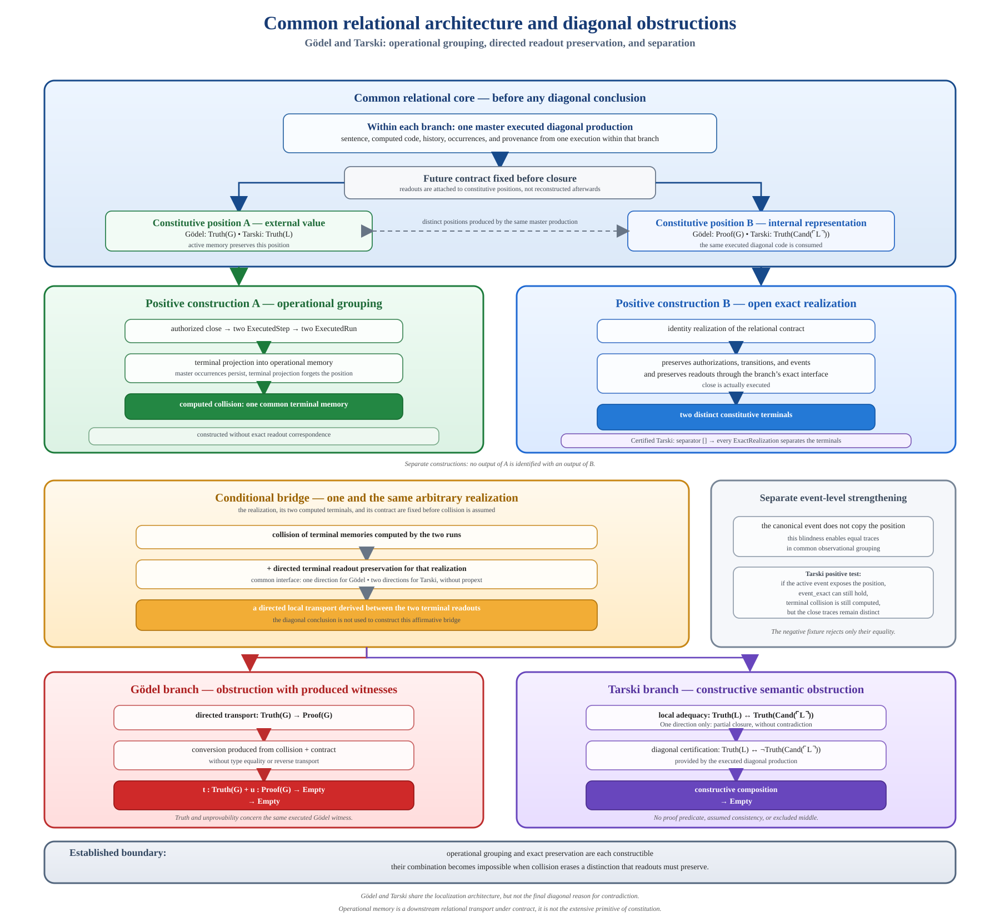

# Constitution, grouping, and obstruction to exact preservation

## Presentation

This document presents a constructive architecture connecting relational
constitution, execution, memory projection, grouping, and preservation of
observations. It synthesizes three scientific claims recorded in the
repository:

- `DIRECTED_OPERATIONAL_READOUT_COMPOSITION`
- `GODEL_OPERATIONAL_RUNTIME_CLOSURE_OBSTRUCTION`
- `TARSKI_RELATIONAL_OPERATIONAL_CLOSURE_OBSTRUCTION`

It does not introduce a fourth claim. It presents the common mechanism, the
positive constructions, and the two diagonal forms already proved.

The central result can be stated as follows:

> **Constitution preserves distinctions. Projection may group them. Local
> factorizations determine which readouts become composable. Exactness fixes
> the conditions under which that composition is admissible or impossible.**

A memory collision therefore does not create an incompatibility. It produces
a composition path between readouts that were previously separated by their
indices. The content of the contract then determines whether that path
transports a witness positively or encounters an obstruction.



## The foundational question

Can a representation identify two outputs without destroying the relations it
must preserve?

This question requires four levels to be distinguished:

1. constituted occurrences and their provenance
2. the executions that produce their terminal states
3. the projection of those states into memory
4. the observations that the contract requires to be reconstructed from that memory

In an extensive framework, equality of two values can easily be read as
identity of the represented objects. The relational framework reverses this
order. An occurrence is constituted by its relations, history, and position
before its projected value is observed. Equality of projections therefore does
not retroact into equality of sources.

Grouping is a downstream operation. It says that two states are represented by
the same memory relative to a specified contract. It does not say that their
occurrences, provenances, or constitutive roles become identical.

## The central mathematical mechanism

Consider:

- two constituted terminals `tₐ` and `tᵦ`
- a memory projection `q`
- a family of terminal readouts `R`
- a family of reads attached to memory `D`

The local factorizations have the following types:

```text
f : R(tₐ) → D(q(tₐ))
g : D(q(tᵦ)) → R(tᵦ)
```

They do not yet construct any transverse transport from `R(tₐ)` to `R(tᵦ)`.
Their memory fibers are indexed separately.

An executed grouping supplies the computed collision:

```text
e : q(tₐ) = q(tᵦ)
```

Applying the family `D` to this equality gives:

```text
congrArg D e : D(q(tₐ)) = D(q(tᵦ))
```

Dependent transport along this equality then makes the two factorizations
composable:

```text
R(tₐ)
  ──f──▶ D(q(tₐ))
  ──transport along e──▶ D(q(tᵦ))
  ──g──▶ R(tᵦ)
```

This yields:

```text
R(tₐ) → R(tᵦ)
```

In the Lean development, this operation is exactly
`DirectedTerminalReadoutPreservation.transport`. The preservation structure
provides `memoryRead`, `sourceForward`, and `targetBackward`. The transport
applies `congrArg memoryRead` to the collision, then uses `Eq.mp` to cross the
resulting equality between the two fibers.

The transverse transport is therefore not a received field. It is produced by
composing two local factorizations along the equality of the terminal memories.

## What the runtime computes

The runtime does not merely illustrate an equality that is already available.
It constructs the data that makes composition possible:

```text
distinct initial sources
  ↓
authorized request
  ↓
two executed steps
  ↓
two nonempty runs
  ↓
two computed terminals
  ↓
equality of their projected memories
```

An `ExecutedOperationalGrouping` contains the two runs, their terminals, and
the terminal collision. The collision reused by the directed bridge is
therefore the one produced by these executions. It is neither reconstructed
from the readouts nor replaced by an abstract equality of the sources.

This organization strictly separates four responsibilities:

| Layer | Function |
| --- | --- |
| Constitution | Form the occurrences, their positions, and their provenance |
| Execution | Produce the steps, events, runs, and terminals |
| Projection | Compute the memories and their possible collision |
| Preservation | Relate the readouts locally to the memory-read fibers |

## Positive non-diagonal construction

The directed mechanism has a complete positive realization that depends on
neither Gödel nor Tarski.

Two distinct accepted sources are already constituted in the same role and the
same master run. The runtime assigns them two positions, `source` and `target`.
Before closure, active memory retains this position. Active events retain it as
well, so the two traces remain distinct.

The `close` request is authorized only in the active phase. The two nonempty
executions produce two distinct terminals. At the terminal, the projection
forgets the position and retains the Boolean actually produced by the existing
relational chain.

Equality of the two Booleans is not postulated. It is derived through the
chain:

```text
same_sources_other_resource_agree
  ↓
produceRoleSignature_exact
  ↓
FutureEquivalent.read
  ↓
equality of the produced Booleans
  ↓
equality of the grouped memories
```

The terminal readouts remain dependent on the produced Booleans. The source
factorization encodes the Boolean as a natural number. The target factorization
decodes it and uses the proved law for decoding after encoding.

The executed grouping and these factorizations construct a terminal transport.
A concrete source witness crosses this transport and becomes a concrete target
witness whose value is exactly the produced target Boolean.

This instance positively establishes three facts at once:

- the constituted sources remain distinct
- their terminal memories can collide
- directed transport can preserve a compatible witness exactly

Composition by collision is therefore positive infrastructure. A contradiction
appears only when the readouts specific to an instance are incompatible with
the produced transport.

## Constructive separation by a finite future

The framework contains a second mechanism, distinct from directed composition.

An exact realization satisfies the principle:

```text
same projected memory
  → same outcomes for every future of the contract
```

A `FutureSeparator` supplies an explicit finite experiment:

```text
r₀ : List Request
different : outcome(tₐ, r₀) ≠ outcome(tᵦ, r₀)
```

Suppose that the two projected memories are equal. Exactness of the realization
then produces equality of the outcomes for every request list. Specializing it
to `r₀` contradicts `different`.

We therefore construct directly:

```text
FutureSeparator(tₐ, tᵦ)
  → q(tₐ) ≠ q(tᵦ)
```

The negation is obtained constructively. The separator contains the finite
request that exhibits the difference. It assumes no global decision procedure
for equivalence of all futures.

This proof localizes the distinction at the observational level. A projection
that claims to preserve futures exactly cannot group two terminals that an
authorized experiment can distinguish.

## Application to Gödel

### Common production

A single executed Gödelian production constructs the sentence `G`, its
history, and the associated witness. A positive master resource then produces
a history `H1` shared by two constitutive sources:

- the semantic pole, whose readout is `Truth(G)`
- the syntactic pole, whose readout is `Proof(G)`

The two sources receive the same production and the same history. Their
positions remain distinct. Any equality of observed values identifies none of
their occurrences.

### Executed grouping

The `close` request is searched for, authorized, and then executed for each
source. Active memories retain the pole and are distinct. After `close`, the
terminal projection forgets the pole and produces a common memory.

This grouping preserves authorizations, transitions, and events without adding
readout exactness. The two runs, their terminals, and their collision are
actually constructed.

### Directed transport

A directed terminal preservation supplies only the necessary local
factorizations. The computed grouping then produces:

```text
Truth(G) → Proof(G)
```

This construction is completed before the two terminal Gödelian data are used:

```text
trueWitness : Truth(G)
unprovable  : Proof(G) → Empty
```

The final rejection is the composition:

```text
unprovable (transport trueWitness) : Empty
```

The obstruction is therefore not located in the execution of `close`. That
execution constructs the collision that makes the factorizations composable.
The incompatibility comes from the truth and unprovability of the same produced
sentence.

### Terminal separator

The nonempty runs `[close]` first produce the two terminals. The separator then
uses the empty list `[]` to observe their already computed readouts immediately.

The witnesses `trueWitness` and `unprovable` certify that these readouts cannot
be equal. Every exact realization of the Gödelian contract must therefore keep
the two terminals in distinct memories.

Gödel thus has two formal paths:

```text
finite separator
  → mandatory separation of exact memories
```

and:

```text
computed collision
+ directed preservation
  → Truth(G) → Proof(G)
+ Gödelian witnesses
  → Empty
```

## Application to Tarski

### Executed diagonal production

An arithmetic truth candidate is received before any diagonalization. A single
syntactic production constructs the diagonal body, executes substitution of its
own code, and produces the sentence `L`.

The semantic readout is added after this production. The two terminal positions
carry:

```text
P = Truth(L)
Q = Truth(Cand(⌜L⌝))
```

The diagonal certification constructively provides:

```text
P → (Q → Empty)
(Q → Empty) → P
```

It represents the directed form of `P ↔ ¬Q`.

### Two necessary transports

Operational grouping computes a common terminal memory without assuming any
readout correspondence. Two opposed terminal preservations then produce:

```text
k : P → Q
ℓ : Q → P
```

The contradiction is entirely constructive. Define:

```text
rejectQ(q) := certification.forward (ℓ(q)) q
p          := certification.backward rejectQ
```

Then:

```text
rejectQ (k(p)) : Empty
```

One direction alone does not suffice for this obstruction. Each direction
separately produces its local consequences. Both transports are required for
the bilateral composition with the diagonal certification.

### Terminal separator

The diagonal certification also proves that the two terminal readouts are
distinct. As in the Gödel branch, the separator uses `[]` to read the terminals
already produced by the two `close` runs.

Every exact realization of the Tarskian contract must therefore separate their
memories. This separation path and the bilateral path are two formally distinct
proofs. Both consume the diagonal content specific to Tarski.

## Two positive possibilities and their boundary

The positive constructions prevent the result from being reduced to a mere
impossibility.

### Possibility of grouping

An operational realization can execute the two sources and compute a common
terminal memory when it does not claim to reconstruct exactly the readout that
distinguishes the terminals.

### Possibility of exact realization

An identity realization can preserve the readouts and futures exactly. It then
keeps the terminals in distinct memories.

### Proved boundary

The obstruction concerns the following combination on the same computed
terminals:

```text
computed terminal collision
+ local readout factorizations
+ incompatibility data specific to the instance
  → Empty
```

Grouping is not intrinsically contradictory. Exactness is not intrinsically
contradictory. The contradiction appears when the collision makes composable
readouts whose content requires them to remain separate.

## The three proved forms

| Form | Decisive data | Realizations |
| --- | --- | --- |
| Separation by a finite future | A finite request distinguishing the outcomes | Generic, non-diagonal, Gödel, and Tarski |
| Incompatible one-way transport | `P → Q`, a witness of `P`, a rejection of `Q` | Gödel |
| Incompatible bilateral transports | `P → Q`, `Q → P`, bilateral negation certificate | Tarski |

These forms share the same operational core: constituted sources, runs,
terminals, and a memory projection. They differ in the information that makes
the collision incompatible with the contract.

## Why the result is relational

The result does not take memory as the primitive of identity. It starts from
occurrences and their constitutive relations, then studies what a downstream
projection can preserve or forget.

This reversal of primitives explains four properties of the architecture:

- the identity of an occurrence is not reduced to equality of its value
- a memory collision does not retroactively identify the sources
- grouping is relative to an explicit contract of futures
- exactness is measured by the transports and observations that the contract requires

Common memory is thus understood as a grouping capacity, not as an extensive
totality that would absorb constitutive distinctions. The relevant question is
no longer only “are these outputs equal?” but “what does their equality make
transportable?”

## Foundational result

Equality changes status in this architecture.

An equality of projected memories is not an equality of sources. It is a path
in the index of a read family. This path can be used to compose local relations
without abolishing the positions that produced them.

The collision therefore has a precise function:

> **It transforms a possibility of grouping into a possibility of
> composition.**

Preservation then determines the direction of that composition. In the
positive instance, it effectively transports a witness. In Gödel, it
transports truth to proof and encounters unprovability. In Tarski, it produces
two directions that the diagonal certification makes incompatible.

The framework thus establishes a constructive boundary among three operations:

```text
constituting occurrences
≠ projecting their states
≠ reconstructing their observations exactly
```

These operations can coexist as long as the produced transports respect the
distinctions imposed by the contract. When a finite observation or a diagonal
certification requires a distinction, every exact realization must preserve it.

## Formal map

The generic mechanism is implemented in:

- [OperationalRealization.lean](../RelationalPerimeter/Constitution/Continuation/OperationalRealization.lean)
- [ReadoutCorrespondence.lean](../RelationalPerimeter/Constitution/Continuation/ReadoutCorrespondence.lean)
- [ExactSeparation.lean](../RelationalPerimeter/Constitution/Continuation/ExactSeparation.lean)
- [DirectedIncompatibility.lean](../RelationalPerimeter/Constitution/Continuation/DirectedIncompatibility.lean)
- [DirectedObstruction.lean](../RelationalPerimeter/Constitution/Continuation/DirectedObstruction.lean)

The positive non-diagonal instance is constructed in:

- [PositiveDirectedComposition.lean](../RelationalPerimeter/Agents/ContinuationSignatures/PositiveDirectedComposition.lean)

The diagonal applications are constructed in:

- [OperationalClosure.lean, Gödel branch](../RelationalPerimeter/Constitution/Godel/OperationalClosure.lean)
- [OperationalClosure.lean, Tarski branch](../RelationalPerimeter/Constitution/Tarski/OperationalClosure.lean)
- [ClosureObstruction.lean](../RelationalPerimeter/Constitution/Tarski/ClosureObstruction.lean)
- [Gödel HA instance](../RelationalPerimeter/Instances/HeytingArithmetic/OperationalClosure.lean)
- [Tarski HA instance](../RelationalPerimeter/Instances/HeytingArithmetic/Tarski.lean)

The detailed scientific texts are:

- [Directed composition under operational grouping](directed-operational-grouping-composition.en.md)
- [Runtime closure and Gödelian distinction](godel-runtime-closure.en.md)
- [Tarski indefinability and operational closure](tarski-indefinability-runtime.en.md)

The [independent Aristotle report](reports/aristotle-directed-operational-composition-80b4bbb.md)
validates the seven fixed criteria for the corresponding proofs, dependencies,
tests, and formulations.

## Conclusion

The development constructs an operational theory of distinction, grouping,
and preservation.

It shows how separately constituted occurrences can produce a common memory
without losing their relational identity. It shows how this common memory makes
local readouts composable. It constructs a case in which this composition
positively transports a witness. Finally, it proves two different ways in
which a diagonal requirement can make the same form of composition impossible.

The conclusion consists of four propositions:

> **Constitution precedes projection.**
>
> **Grouping is not identification of sources.**
>
> **Collision produces a composition path.**
>
> **Exactness must preserve every distinction made necessary by futures or
> readouts.**
