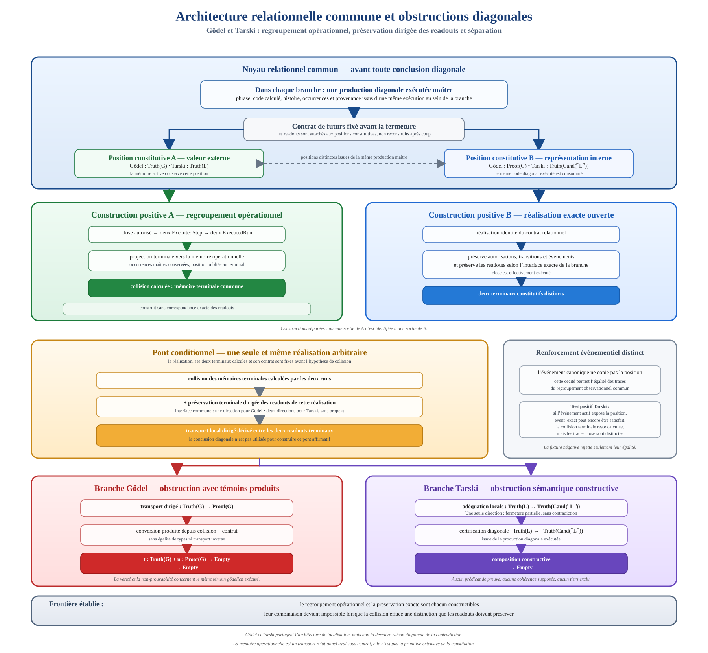

# Constitution, regroupement et obstruction à la préservation exacte

## Présentation

Ce document présente une architecture constructive reliant constitution
relationnelle, exécution, projection mémoire, regroupement et préservation des
observations. Il synthétise trois affirmations scientifiques enregistrées dans
le dépôt :

- `DIRECTED_OPERATIONAL_READOUT_COMPOSITION`
- `GODEL_OPERATIONAL_RUNTIME_CLOSURE_OBSTRUCTION`
- `TARSKI_RELATIONAL_OPERATIONAL_CLOSURE_OBSTRUCTION`

Il n'introduit pas une quatrième affirmation. Il expose le mécanisme commun,
les constructions positives et les deux formes diagonales déjà démontrées.

Le résultat central peut se formuler ainsi :

> **La constitution conserve les distinctions. La projection peut les
> regrouper. Les factorisations locales déterminent quelles lectures deviennent
> composables. L'exactitude fixe les conditions sous lesquelles cette
> composition est admissible ou impossible.**

La collision des mémoires ne crée donc pas une incompatibilité. Elle produit
un chemin de composition entre des lectures auparavant séparées par leurs
indices. Le contenu propre du contrat détermine ensuite si ce chemin transporte
un témoin de façon positive ou rencontre une obstruction.



## La question fondationnelle

Une représentation peut-elle identifier deux sorties sans détruire les
relations qu'elle doit préserver ?

Cette question demande de distinguer quatre niveaux :

1. les occurrences constituées et leur provenance
2. les exécutions qui produisent leurs états terminaux
3. la projection de ces états dans une mémoire
4. les observations que le contrat exige de reconstruire depuis cette mémoire

Dans un cadre extensif, l'égalité de deux valeurs peut facilement être lue
comme une identité des objets représentés. Le cadre relationnel inverse cet
ordre. L'occurrence est constituée par ses relations, son histoire et sa
position avant que sa valeur projetée soit observée. L'égalité des projections
ne rétroagit donc pas en une égalité des sources.

Le regroupement est une opération aval. Il dit que deux états sont représentés
par une même mémoire relativement à un contrat déterminé. Il ne dit pas que
leurs occurrences, leurs provenances ou leurs rôles constitutifs deviennent
identiques.

## Le mécanisme mathématique central

Considérons :

- deux terminaux constitués `tₐ` et `tᵦ`
- une projection mémoire `q`
- une famille de readouts terminaux `R`
- une famille de lectures attachée à la mémoire `D`

Les factorisations locales ont les types suivants :

```text
f : R(tₐ) → D(q(tₐ))
g : D(q(tᵦ)) → R(tᵦ)
```

Elles ne construisent encore aucun transport transversal de `R(tₐ)` vers
`R(tᵦ)`. Leurs fibres mémoire sont indexées séparément.

Un regroupement exécuté apporte la collision calculée :

```text
e : q(tₐ) = q(tᵦ)
```

L'application de la famille `D` à cette égalité donne :

```text
congrArg D e : D(q(tₐ)) = D(q(tᵦ))
```

Le transport dépendant dans cette égalité rend alors les deux factorisations
composables :

```text
R(tₐ)
  ──f──▶ D(q(tₐ))
  ──transport le long de e──▶ D(q(tᵦ))
  ──g──▶ R(tᵦ)
```

On obtient ainsi :

```text
R(tₐ) → R(tᵦ)
```

Dans le développement Lean, cette opération est exactement
`DirectedTerminalReadoutPreservation.transport`. La structure de préservation
fournit `memoryRead`, `sourceForward` et `targetBackward`. Le transport applique
`congrArg memoryRead` à la collision, puis utilise `Eq.mp` pour traverser
l'égalité obtenue entre les deux fibres.

Le transport transversal n'est donc pas un champ reçu. Il est produit par la
composition de deux factorisations locales le long de l'égalité des mémoires
terminales.

## Ce que calcule le runtime

Le runtime ne sert pas uniquement à illustrer une égalité déjà disponible. Il
construit les données qui rendent la composition possible :

```text
sources initiales distinctes
  ↓
requête autorisée
  ↓
deux étapes exécutées
  ↓
deux runs non vides
  ↓
deux terminaux calculés
  ↓
égalité de leurs mémoires projetées
```

Un `ExecutedOperationalGrouping` contient les deux runs, leurs terminaux et la
collision terminale. La collision réutilisée par le pont dirigé est donc celle
produite par ces exécutions. Elle n'est ni reconstruite à partir des readouts,
ni remplacée par une égalité abstraite des sources.

Cette organisation sépare strictement quatre responsabilités :

| Couche | Fonction |
| --- | --- |
| Constitution | Former les occurrences, leurs positions et leur provenance |
| Exécution | Produire les étapes, les événements, les runs et les terminaux |
| Projection | Calculer les mémoires et leur collision éventuelle |
| Préservation | Relier localement les readouts aux fibres de lecture mémoire |

## Construction positive non diagonale

Le mécanisme dirigé possède une réalisation positive complète qui ne dépend ni
de Gödel ni de Tarski.

Deux sources acceptées distinctes sont déjà constituées dans un même rôle et
un même run maître. Le runtime leur associe deux positions, `source` et
`target`. Avant la fermeture, la mémoire active conserve cette position. Les
événements actifs la conservent également, de sorte que les deux traces
restent distinctes.

La requête `close` est autorisée seulement en phase active. Les deux exécutions
non vides produisent deux terminaux distincts. Au terminal, la projection
oublie la position et conserve le booléen effectivement produit par la chaîne
relationnelle existante.

L'égalité des deux booléens n'est pas postulée. Elle est dérivée de la chaîne :

```text
same_sources_other_resource_agree
  ↓
produceRoleSignature_exact
  ↓
FutureEquivalent.read
  ↓
égalité des booléens produits
  ↓
égalité des mémoires grouped
```

Les readouts terminaux restent dépendants des booléens produits. La
factorisation source encode le booléen en nombre naturel. La factorisation
cible le décode et utilise la loi démontrée du décodage après encodage.

Le regroupement exécuté et ces factorisations construisent un transport
terminal. Un témoin source concret traverse ce transport et devient un témoin
cible concret dont la valeur est exactement le booléen cible produit.

Cette instance établit positivement trois faits simultanés :

- les sources constituées restent distinctes
- leurs mémoires terminales peuvent collisionner
- le transport dirigé peut préserver exactement un témoin compatible

La composition par collision est donc une infrastructure positive. Une
contradiction n'apparaît que lorsque les lectures propres à une instance sont
incompatibles avec le transport produit.

## Séparation constructive par un futur fini

Le cadre contient un second mécanisme, distinct de la composition dirigée.

Une réalisation exacte satisfait le principe :

```text
même mémoire projetée
  → mêmes résultats pour tous les futurs du contrat
```

Un `FutureSeparator` apporte une expérience finie explicite :

```text
r₀ : List Request
different : outcome(tₐ, r₀) ≠ outcome(tᵦ, r₀)
```

Supposons que les deux mémoires projetées soient égales. L'exactitude de la
réalisation produit alors l'égalité des résultats pour toute liste de requêtes.
Sa spécialisation à `r₀` contredit `different`.

On construit donc directement :

```text
FutureSeparator(tₐ, tᵦ)
  → q(tₐ) ≠ q(tᵦ)
```

La négation est obtenue constructivement. Le séparateur contient la requête
finie qui manifeste la différence. Il ne suppose aucune décision globale sur
l'équivalence de tous les futurs.

Cette preuve localise la distinction au niveau observationnel. Une projection
qui prétend préserver exactement les futurs ne peut regrouper deux terminaux
qu'une expérience autorisée sait différencier.

## Application à Gödel

### Production commune

Une unique production gödelienne exécutée construit la phrase `G`, son histoire
et le témoin associé. Une ressource positive maître produit ensuite une
histoire `H1` partagée par deux sources constitutives :

- le pôle sémantique, dont le readout est `Truth(G)`
- le pôle syntaxique, dont le readout est `Proof(G)`

Les deux sources reçoivent la même production et la même histoire. Leur
position demeure distincte. L'égalité éventuelle de valeurs observées
n'identifie aucune de leurs occurrences.

### Regroupement exécuté

La requête `close` est recherchée, autorisée puis exécutée pour chaque source.
Les mémoires actives conservent le pôle et sont distinctes. Après `close`, la
projection terminale oublie le pôle et produit une mémoire commune.

Ce regroupement préserve les autorisations, les transitions et les événements
sans ajouter l'exactitude du readout. Les deux runs, leurs terminaux et leur
collision sont réellement construits.

### Transport dirigé

Une préservation terminale dirigée fournit seulement les factorisations
locales nécessaires. Le regroupement calculé produit alors :

```text
Truth(G) → Proof(G)
```

Cette construction est achevée avant l'utilisation des deux données
gödeliennes terminales :

```text
trueWitness : Truth(G)
unprovable  : Proof(G) → Empty
```

Le rejet final est la composition :

```text
unprovable (transport trueWitness) : Empty
```

L'obstruction ne se trouve donc pas dans l'exécution de `close`. Cette
exécution construit la collision qui rend les factorisations composables.
L'incompatibilité provient de la vérité et de la non-prouvabilité du même
énoncé produit.

### Séparateur terminal

Les runs non vides `[close]` produisent d'abord les deux terminaux. Le
séparateur utilise ensuite la liste vide `[]` pour observer immédiatement
leurs readouts déjà calculés.

Les témoins `trueWitness` et `unprovable` certifient que ces readouts ne peuvent
être égaux. Toute réalisation exacte du contrat gödelien doit donc conserver
les deux terminaux dans des mémoires distinctes.

Gödel possède ainsi deux chemins formels :

```text
séparateur fini
  → séparation obligatoire des mémoires exactes
```

et :

```text
collision calculée
+ préservation dirigée
  → Truth(G) → Proof(G)
+ témoins gödeliens
  → Empty
```

## Application à Tarski

### Production diagonale exécutée

Un candidat arithmétique de vérité est reçu avant toute diagonalisation. Une
production syntaxique unique construit le corps diagonal, exécute la
substitution à son propre code et produit la phrase `L`.

Le readout sémantique est ajouté après cette production. Les deux positions
terminales portent :

```text
P = Truth(L)
Q = Truth(Cand(⌜L⌝))
```

La certification diagonale fournit constructivement :

```text
P → (Q → Empty)
(Q → Empty) → P
```

Elle représente la forme dirigée de `P ↔ ¬Q`.

### Deux transports nécessaires

Le regroupement opérationnel calcule une mémoire terminale commune sans
supposer de correspondance des readouts. Deux préservations terminales
opposées produisent ensuite :

```text
k : P → Q
ℓ : Q → P
```

La contradiction est entièrement constructive. On définit :

```text
rejectQ(q) := certification.forward (ℓ(q)) q
p          := certification.backward rejectQ
```

Puis :

```text
rejectQ (k(p)) : Empty
```

Une seule direction ne suffit pas à cette obstruction. Chaque direction
produit séparément ses conséquences locales. Les deux transports sont requis
pour la composition bilatérale avec la certification diagonale.

### Séparateur terminal

La certification diagonale démontre aussi que les deux readouts terminaux sont
distincts. Comme dans la branche Gödel, le séparateur utilise `[]` pour lire
les terminaux déjà produits par les deux runs `close`.

Toute réalisation exacte du contrat tarskien doit donc séparer leurs mémoires.
Ce chemin de séparation et le chemin bilatéral sont deux preuves formellement
distinctes. Ils consomment tous deux le contenu diagonal propre à Tarski.

## Deux possibilités positives et leur frontière

Les constructions positives empêchent de réduire le résultat à une simple
impossibilité.

### Possibilité de regroupement

Une réalisation opérationnelle peut exécuter les deux sources et calculer une
mémoire terminale commune lorsqu'elle ne prétend pas reconstruire exactement
le readout qui distingue les terminaux.

### Possibilité de réalisation exacte

Une réalisation identité peut préserver exactement les readouts et les futurs.
Elle conserve alors les terminaux dans des mémoires distinctes.

### Frontière démontrée

L'obstruction concerne la combinaison suivante sur les mêmes terminaux
calculés :

```text
collision terminale calculée
+ factorisations locales du readout
+ données d'incompatibilité propres à l'instance
  → Empty
```

Le regroupement n'est pas intrinsèquement contradictoire. L'exactitude n'est
pas intrinsèquement contradictoire. La contradiction apparaît quand la
collision rend composables des lectures dont le contenu exige qu'elles restent
séparées.

## Les trois formes démontrées

| Forme | Données décisives | Réalisations |
| --- | --- | --- |
| Séparation par futur fini | Une requête finie distinguant les issues | Générique, non diagonale, Gödel et Tarski |
| Transport unidirectionnel incompatible | `P → Q`, un témoin de `P`, un rejet de `Q` | Gödel |
| Transports bilatéraux incompatibles | `P → Q`, `Q → P`, certificat bilatéral de négation | Tarski |

Ces formes partagent le même noyau opérationnel : des sources constituées, des
runs, des terminaux et une projection mémoire. Elles diffèrent par
l'information qui rend la collision incompatible avec le contrat.

## Pourquoi le résultat est relationnel

Le résultat ne prend pas la mémoire comme primitive de l'identité. Il part des
occurrences et de leurs relations constitutives, puis étudie ce qu'une
projection aval peut conserver ou oublier.

Cette inversion des primitives explique quatre propriétés de l'architecture :

- l'identité d'une occurrence ne se réduit pas à l'égalité de sa valeur
- une collision mémoire n'identifie pas rétroactivement les sources
- un regroupement est relatif à un contrat de futurs explicite
- l'exactitude se mesure aux transports et observations que ce contrat exige

La mémoire commune est ainsi comprise comme une capacité de regroupement, non
comme une totalité extensive qui absorberait les distinctions constitutives.
La question pertinente n'est plus seulement « ces sorties sont-elles égales ? »
mais « que rend transportable leur égalité ? ».

## Résultat fondationnel

L'égalité change de statut dans cette architecture.

Une égalité de mémoires projetées n'est pas une égalité des sources. Elle est
un chemin dans l'indice d'une famille de lecture. Ce chemin peut être utilisé
pour composer des relations locales sans abolir les positions qui les ont
produites.

La collision possède donc une fonction précise :

> **Elle transforme une possibilité de regroupement en possibilité de
> composition.**

La préservation détermine ensuite le sens de cette composition. Dans l'instance
positive, elle transporte effectivement un témoin. Chez Gödel, elle transporte
la vérité vers la preuve et rencontre la non-prouvabilité. Chez Tarski, elle
produit deux directions que la certification diagonale rend incompatibles.

Le cadre établit ainsi une frontière constructive entre trois opérations :

```text
constituer des occurrences
≠ projeter leurs états
≠ reconstruire exactement leurs observations
```

Ces opérations peuvent coexister tant que les transports produits respectent
les distinctions imposées par le contrat. Lorsqu'une observation finie ou une
certification diagonale exige une distinction, toute réalisation exacte doit
la conserver.

## Carte formelle

Le mécanisme générique est implémenté dans :

- [OperationalRealization.lean](../RelationalPerimeter/Constitution/Continuation/OperationalRealization.lean)
- [ReadoutCorrespondence.lean](../RelationalPerimeter/Constitution/Continuation/ReadoutCorrespondence.lean)
- [ExactSeparation.lean](../RelationalPerimeter/Constitution/Continuation/ExactSeparation.lean)
- [DirectedIncompatibility.lean](../RelationalPerimeter/Constitution/Continuation/DirectedIncompatibility.lean)
- [DirectedObstruction.lean](../RelationalPerimeter/Constitution/Continuation/DirectedObstruction.lean)

L'instance positive non diagonale est construite dans :

- [PositiveDirectedComposition.lean](../RelationalPerimeter/Agents/ContinuationSignatures/PositiveDirectedComposition.lean)

Les applications diagonales sont construites dans :

- [OperationalClosure.lean, branche Gödel](../RelationalPerimeter/Constitution/Godel/OperationalClosure.lean)
- [OperationalClosure.lean, branche Tarski](../RelationalPerimeter/Constitution/Tarski/OperationalClosure.lean)
- [ClosureObstruction.lean](../RelationalPerimeter/Constitution/Tarski/ClosureObstruction.lean)
- [instance HA de Gödel](../RelationalPerimeter/Instances/HeytingArithmetic/OperationalClosure.lean)
- [instance HA de Tarski](../RelationalPerimeter/Instances/HeytingArithmetic/Tarski.lean)

Les textes scientifiques détaillés sont :

- [Composition dirigée sous regroupement opérationnel](composition-dirigee-regroupement-operationnel.fr.md)
- [Fermeture runtime et distinction gödelienne](godel-fermeture-runtime.fr.md)
- [Indéfinissabilité de Tarski et fermeture opérationnelle](tarski-indefinissabilite-runtime.fr.md)

Le [rapport indépendant Aristotle](reports/aristotle-directed-operational-composition-80b4bbb.md)
valide les sept critères fixés pour les preuves, les dépendances, les tests et
les formulations correspondantes.

## Conclusion

Le développement construit une théorie opérationnelle de la distinction, du
regroupement et de la préservation.

Il montre comment des occurrences constituées séparément peuvent produire une
mémoire commune sans perdre leur identité relationnelle. Il montre comment
cette mémoire commune rend composables des lectures locales. Il construit un
cas où cette composition transporte positivement un témoin. Il démontre enfin
deux façons différentes dont une exigence diagonale peut rendre la même forme
de composition impossible.

La conclusion tient en quatre propositions :

> **La constitution précède la projection.**
>
> **Le regroupement n'est pas l'identification des sources.**
>
> **La collision produit un chemin de composition.**
>
> **L'exactitude doit conserver toute distinction que les futurs ou les
> readouts rendent nécessaire.**
